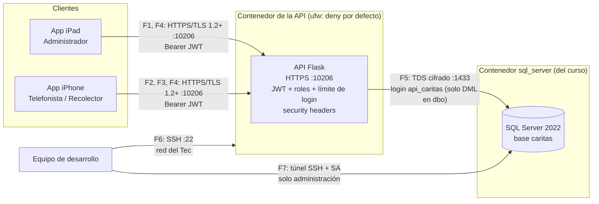

# Diseño de integración

## Componentes

| Componente | Dónde corre | Quién lo usa |
|---|---|---|
| App de iPad (SwiftUI) | iPad del personal de Cáritas | Administrador: Resumen, Donantes, Metas, Reportes, Perfil |
| App de iPhone (SwiftUI) | iPhone del personal de campo | Telefonista (llamadas, agendar visita) y Recolector (cobros) |
| API REST (Flask) | Contenedor del equipo, `https://losjamones.tc2007b.tec.mx:10206` | Las dos apps |
| SQL Server 2022, base `caritas` | Contenedor `sql_server` del curso, puerto 1433 | Solo la API (y el equipo para administrar) |
| ufw | Contenedor de la API | Filtra lo que entra al contenedor |

## Diagrama

## Tabla de flujos

| Flujo | Origen → Destino | Protocolo y puerto | Autenticación | Datos que viajan | Controles |
|---|---|---|---|---|---|
| F1 | App iPad → API | HTTPS, TCP 10206 | JWT `Bearer` de un usuario con sesión | KPIs, metas, donantes, reportes (JSON, PDF, Excel, CSV) | TLS con certificado de la CA del curso; `@requiere_sesion`; security headers; `Cache-Control: no-store` |
| F2 | App iPhone (Telefonista) → API | HTTPS, TCP 10206 | JWT con rol `TELEFONISTA` | Donantes, llamadas, compromisos, visitas agendadas | `@requiere_rol("TELEFONISTA")`; validación con Pydantic; consultas parametrizadas |
| F3 | App iPhone (Recolector) → API | HTTPS, TCP 10206 | JWT con rol `RECOLECTOR` | Cobros pendientes, historial, resultado de la visita | `@requiere_rol("RECOLECTOR")`; validación con Pydantic; un cobro solo se registra una vez (409) |
| F4 | Apps → `POST /auth/login` | HTTPS, TCP 10206 | Correo y contraseña | Credenciales de ida; JWT y datos del usuario de regreso | Contraseñas con scrypt, sal por usuario y pepper en el `.env`; JWT HS256 de 8 horas; 5 intentos fallidos por minuto por IP (luego 429) |
| F5 | API → SQL Server | TDS, TCP 1433 (`Encrypt=yes`) | Login `api_caritas` | Consultas y escrituras de filas | Mínimo privilegio: solo `SELECT/INSERT/UPDATE/DELETE` sobre `dbo`; credenciales en `.env` con permisos 600, fuera de git |
| F6 | Equipo → contenedor de la API | SSH, TCP 22 | Usuario y contraseña del contenedor | Despliegues, logs | ufw solo deja entrar SSH (22), la API (10206) y dos puertos UDP de administración (123 y 41641) |
| F7 | Equipo → SQL Server | TDS por túnel SSH | `SA` | Esquema, cargas de datos, respaldos | SA no lo usa la API; sus credenciales viven en un archivo aparte (permisos 600) que solo leen los scripts de administración |

## Rutas de la API por rol

| Prefijo | Rol | Rutas |
|---|---|---|
| `/auth` | Público / sesión / administrador | `POST /login` (público, con límite), `GET /perfil`, `GET /usuarios` (sesión), `POST /registro` (administrador) |
| `/resumen`, `/metas`, `/donantes`, `/reportes` | Cualquier sesión | Lectura de indicadores, metas, donantes y reportes; `POST /reportes`. Excepción pendiente: `/reportes/<id>/datos`, `/csv` y `/archivo` todavía no piden token (riesgo R9) |
| `/llamadas`, `/donantes/<id>/llamadas`, `/visitas` | Telefonista | Opciones del formulario, historial, registrar llamada, agendar visita (`/visitas/municipios` con cualquier sesión) |
| `/cobros` | Recolector | Pendientes, detalle, historial, registrar visita |
| `/salud`, `/hello` | Público | Monitoreo, sin datos |
