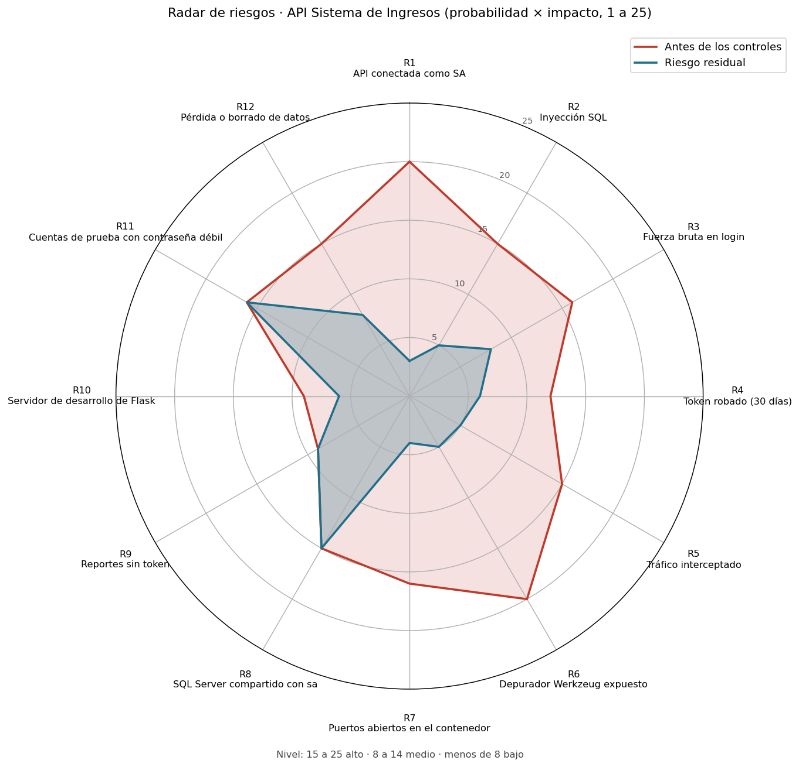

# Radar de riesgos

Escala de 1 a 5 para probabilidad (P) e impacto (I). Nivel = P × I: **15 a 25 alto**, 8 a 14 medio, menos de 8 bajo.
"Antes" es el estado del 13/10/2026 por la mañana; "Residual" es después de los controles de esta entrega.

| ID | Riesgo | Activo afectado | P | I | Antes | Control | P | I | Residual |
|---|---|---|---|---|---|---|---|---|---|
| R1 | La API se conecta a SQL Server como `SA`: si alguien toma la API, controla todo el servidor | Base `caritas` y las demás bases del servidor | 4 | 5 | **20** | Login `api_caritas` con solo `SELECT/INSERT/UPDATE/DELETE` sobre el esquema `dbo` (`db/03_usuario_api.sql`). Se probó que no puede crear, alterar ni borrar tablas, ni entrar a otras bases, ni hacer respaldos | 1 | 3 | 3 |
| R2 | Inyección SQL en los parámetros de las rutas | Datos de donantes y cobros | 3 | 5 | **15** | Todas las consultas usan parámetros `?` de pyodbc; los nombres de tabla que se arman con f-string vienen de constantes del código. Bandit sin hallazgos en el código de Reportes | 1 | 5 | 5 |
| R3 | Fuerza bruta o adivinación de contraseñas en `/auth/login` | Cuentas de usuario | 4 | 4 | **16** | Límite de 5 intentos fallidos por minuto por IP; el sexto responde 429 con `Retry-After: 60` | 2 | 4 | 8 |
| R4 | Un token robado sirve 30 días | Sesiones | 3 | 4 | 12 | Vigencia del JWT bajada a 8 horas (`JWT_MINUTOS_EXPIRACION=480`), firma HS256 con secreto de 64 caracteres fuera del repo | 2 | 3 | 6 |
| R5 | Tráfico interceptado entre las apps y la API | Contraseñas, tokens, datos de donantes | 3 | 5 | **15** | Solo HTTPS (certificado firmado por la CA del curso, dominio `losjamones.tc2007b.tec.mx`) y `Strict-Transport-Security` | 1 | 5 | 5 |
| R6 | Copia vieja de la API con `debug=True` y la consola de Werkzeug en el puerto 5000 (ejecución de código remoto) | Contenedor completo | 4 | 5 | **20** | Proceso eliminado, puerto 5000 cerrado en ufw, `debug=True` quitado de `main.py` y `FLASK_DEBUG=0` en `.env.example` | 1 | 5 | 5 |
| R7 | Puertos del contenedor abiertos sin necesidad | Contenedor | 4 | 4 | **16** | ufw con `deny` por defecto; solo 22 (SSH), 10206 (API) y dos puertos UDP de administración (123 y 41641) | 1 | 4 | 4 |
| R8 | SQL Server es compartido por todo el curso y otros equipos entran con `sa`: pueden leer o borrar la base `caritas` | Base `caritas` | 3 | 5 | **15** | No depende de nosotros. Mitigación: respaldos `.bak` antes de cada cambio de datos. Hay que pedir al profesor que cambie la contraseña de `sa` o que cada equipo tenga su propio login | 3 | 5 | **15** |
| R9 | `/reportes/<id>/datos`, `/csv` y `/archivo` responden sin token | Datos de cobranza agregados | 3 | 3 | 9 | Pendiente: proteger con `@requiere_sesion` y mandar el token desde la app del iPad | 3 | 3 | 9 |
| R10 | La API corre con el servidor de desarrollo de Flask (un proceso, anuncia `Werkzeug/x.y Python/x.y` en el header `Server`) | Disponibilidad | 3 | 3 | 9 | Riesgo aceptado para el reto. Para producción: gunicorn con `--certfile/--keyfile` o detrás de nginx | 3 | 2 | 6 |
| R11 | Cuentas de prueba con contraseñas triviales, una de ellas de administrador | Todo el sistema | 4 | 4 | **16** | Pendiente: borrarlas o cambiarlas antes de entregar a Cáritas. Las contraseñas se guardan con scrypt, sal por usuario y pepper | 4 | 4 | **16** |
| R12 | Pérdida de datos por un borrado accidental o por volver a correr `01_esquema.sql` (que hace `DROP TABLE`) | Base `caritas` | 3 | 5 | **15** | `api_caritas` no puede borrar tablas; respaldos `.bak` en el servidor; los scripts de esquema solo los corre un administrador con SA | 2 | 4 | 8 |

## Riesgos que quedan altos

- **R8**: necesita al profesor (dueño del servidor SQL).
- **R11**: es borrar o cambiar las cuentas de prueba antes de la entrega final.
